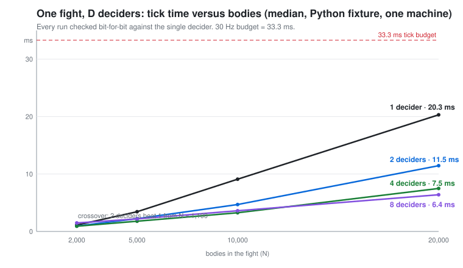

# Dense Melee Lab

**How many players can fight in one spot, and what does it cost to let more than one server decide the fight?**

Reproducible netcode research for dense melee: 200 fighters inside a 6 by 40 metre gate at 30 Hz, a replication tier built on unmodified Unity Netcode for Entities, and a fixture in which 2, 4 and 8 deciders resolve one fight **bit-identically to a single decider** while cutting the tick by 3×.

[](LICENSE)




## Three results

**1. The single-server wall is the send side, not hit detection.** Two independent fixtures (a native C++ lab with 200 real UDP endpoints and a numpy harness checked against an exhaustive float64 oracle) agree that the server work of 200 fighters in a confined arena fits a 33 ms tick on one core with room to spare. Past roughly 400 mutually visible players the per-client datagram cost runs out before the collision work does. [Part 1](docs/part1-single-decider.md)

**2. A replica tier works on unmodified Netcode for Entities, with numbers.** One process that holds a client world joined to the authority and a server world that re-hosts the same ghosts to its own clients. The authority's tick cost falls by about 4× with one replica, a per-entity seal verified end to end found 0 mismatches in hundreds of millions of checks, and a client behind the replica predicts its own character as well as a direct client under three stated conditions. [Part 2](docs/part2-replica-tier.md)

**3. Several deciders, one fight, exact.** With a boundary exchange inside every tick, a 3 m halo and a canonical order for hits that land on one target, 2 to 8 deciders reproduce the single decider's hits, HP, positions and death ticks bit for bit, in separate OS processes, across 275 verified runs. Two deciders beat one from about 1,100 bodies; eight deciders cut a 20,000-body tick from 20 ms to 6.4 ms. Any delay on boundary positions breaks the equivalence at tick 1, and a construction that restores it under delay is measured too. [Part 3](docs/part3-many-deciders.md)

## Quick start

The Part 3 fixtures need only Python 3.12, numpy and scipy. No game engine.

```bash
pip install numpy scipy
python part3/equivalence/replay_deciders.py --n 2000 --deciders 1,2,4,8 --delay 0,1,2
python part3/equivalence/replay_deciders.py --summarize
```

This replays one recorded fight through 1, 2, 4 and 8 deciders and diffs every tick. The summary prints the equivalence line (expect 0 / 0 / 0 at delay 0) and the damage at delay 1 and 2. Each configuration takes seconds at N = 2,000 and about a minute at N = 10,000.

To measure what the barrier costs in real processes:

```bash
python part3/barrier-cost/barrier_cost.py --n 2000,10000 --deciders 1,2,4,8
python part3/barrier-cost/barrier_cost.py --summarize
```

The Part 1 numpy harness runs the whole 200-player pipeline, including loopback UDP, and checks itself against the oracle:

```bash
python part1/numpy-harness/dense_melee_bench.py all
```

## What is in the repository

```
part1/
  native-lab/        C++ combat lab: 200 actors, 6,400 hurtboxes, 1,000 projectiles, 200 UDP endpoints
  numpy-harness/     full server pipeline in numpy with an exhaustive oracle, plus scalar kernel benches (.NET, V8)
  model/             2D workload model and the counterexamples that killed earlier shortcuts
part2/
  memory-model/      Netcode for Entities snapshot-history memory, predicted from the package source and compared
part3/
  equivalence/       replay one fight through D deciders, diff every tick (equivalence fixture)
  barrier-cost/      the same simulation in D OS processes with shared-memory mailboxes and a spin barrier (cost fixture)
docs/
  part1-single-decider.md   part2-replica-tier.md   part3-many-deciders.md
  related-work.md           methodology.md
```

Every fixture writes a JSON per run with the script's SHA-256, the machine, and the raw per-tick numbers. Results refuse to overwrite. Failures are kept.

## What is deliberately not here

- **Full result tables and raw runs.** The documents give headline numbers and the shape of each curve. The complete tables, the raw JSON of several hundred runs and the Unity harness that produced the Part 2 measurements belong to an unannounced game project and are withheld for now. The fixtures regenerate the Part 1 and Part 3 numbers on your machine.
- **The game.** Nothing here describes a game design. The fixtures use generic melee rules: 0.35 m bodies, a 15-tick swing, 120 damage, 4,000 HP, four weapon shapes, a 4 m area effect.

## Limits, in one paragraph

Everything was measured on one desktop (Intel i5-13400F, Windows 11) and once on a rented Linux machine. The Part 3 fixture is Python and numpy, so its absolute times are an upper bound and its exchange cost is mostly interpreter overhead. Deciders talk through shared memory on one machine: no network hop, no jitter, no loss between them. One recorded fight per population and layout. Part 2 ran on thin clients; no human has played through the replica tier. Part 1 has no engine, no rendered client and no human either. Read the Limits section of each document before quoting a number.

## Reproductions

Independent runs of the Part 3 equivalence fixture, checked against the maintainer's machine. The fixture is deterministic, so a real run matches hit counts and cross-hit shares exactly.

| Who | Machine | Python / numpy / scipy | N | Result | Report |
|---|---|---|---|---|---|
| @ashwinruke | Intel i5-1135G7 laptop, Windows 11 | 3.14.7 / 2.5.4 / 1.18.1 | 2,000 | matches: equivalence 0 at delay 0 for D = 2, 4, 8; divergence at delay 1 and 2 as documented | [#11](https://github.com/QuinCyMP/dense-melee-lab/issues/11) |

Add yours through the Reproduction report issue template; see [#1](https://github.com/QuinCyMP/dense-melee-lab/issues/1).

## Contributing

Reproduce a run on your hardware and post the summary line. That is the most useful contribution and it is the first issue. Then see [CONTRIBUTING.md](CONTRIBUTING.md) and the open issues for a real UDP hop between deciders, a native port of the fixture kernel, plots and CI.

## Citation

```bibtex
@misc{densemeleelab2026,
  title  = {Dense Melee Lab: single-server limits, a replica tier on Netcode for Entities, and exact many-decider resolution of one fight},
  author = {QuinCyMP},
  year   = {2026},
  url    = {https://github.com/QuinCyMP/dense-melee-lab}
}
```

## How this was made

The experiments were designed, run and written up by AI coding agents (Claude Code and OpenAI Codex) directed by one person, over about five weeks, with every claim tied to a run file and every run file tied to a source hash. [docs/methodology.md](docs/methodology.md) says how, including what that process got wrong and how the wrong claims were caught.

## License

[MIT](LICENSE) © 2026 QuinCyMP
